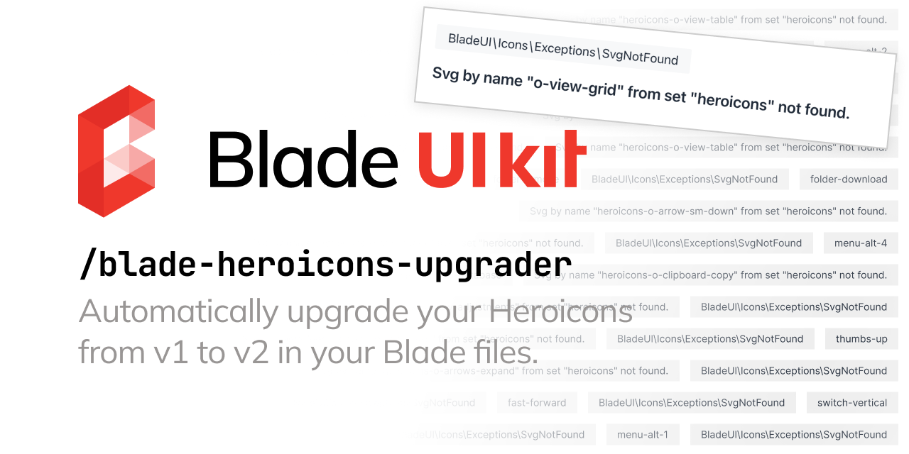
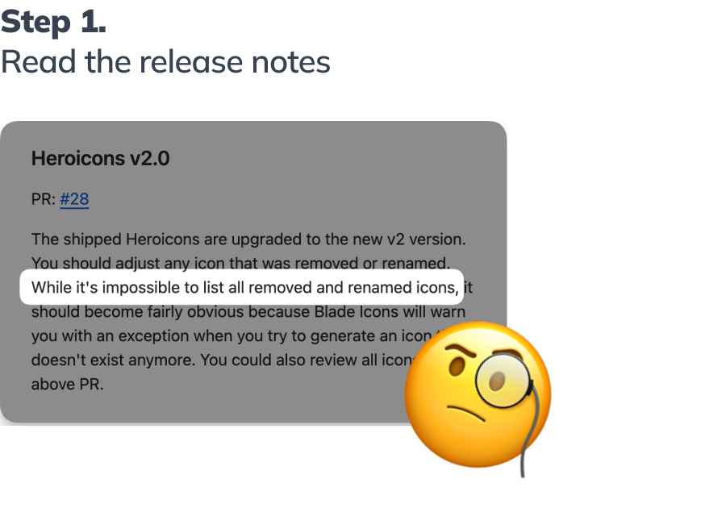
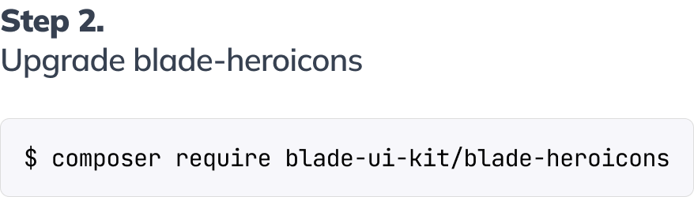
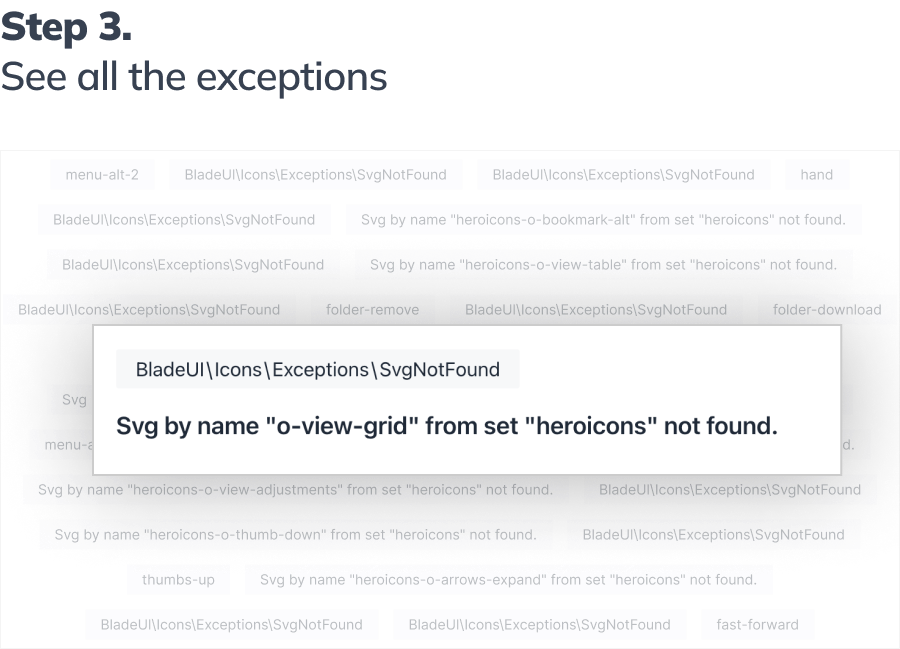
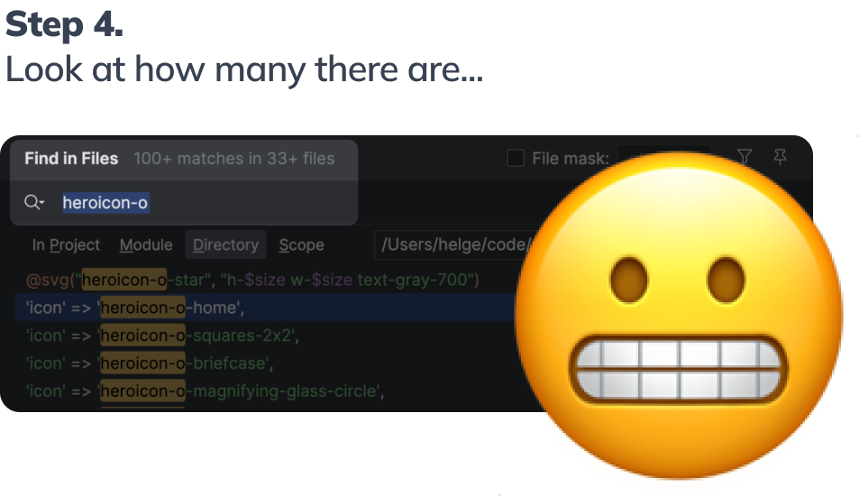
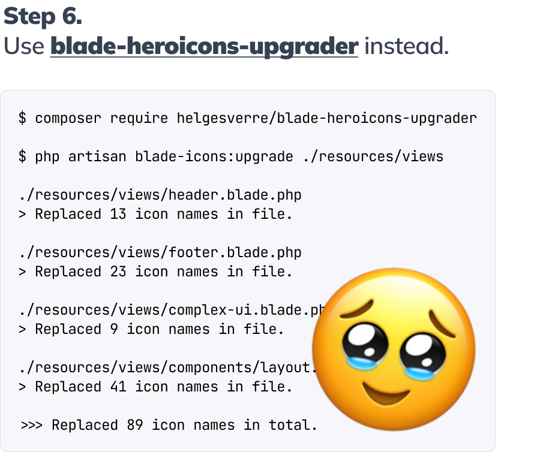

<p align="center"></p>

# Blade Heroicons Upgrader

[](https://packagist.org/packages/helgesverre/blade-heroicons-upgrader)
[](https://github.com/helgesverre/blade-heroicons-upgrader/actions?query=workflow%3Atests+branch%3Amain)
[](https://packagist.org/packages/helgesverre/blade-heroicons-upgrader)

## Storytime.

[Skip to installation](#installation)


<br><br>


<br><br>


<br><br>


<br><br>


<br><br>


<br><br>

## What it does.

> This only supports [Blade Heroicons](https://github.com/blade-ui-kit/blade-heroicons).

🔧 Blade Heroicons Upgrader is a Laravel tool specifically designed for updating from Heroicons v1 to v2 in Blade files.
It simplifies the process of transitioning to the latest Blade Heroicons version, making it quick and effortless.

This tool replaces old icon names in your code, such as `@svg("clipboard-check")` and `<x-clipboard-check />`, and
updates them to their new v2 equivalents such as `@svg("clipboard-document-check")`
and `<x-clipboard-document-check />`.

It's built to prevent overlapping or incorrect updates, ensuring that icons are not mistakenly transformed into
something
like `<x-heroicon-o-server-stack-stack />`.

## Requirements

- **PHP**: 8.1 or higher
- **Laravel**: 10.17+, 11.x, or 12.x
    - Laravel 10.17+ is required due to the `laravel/prompts` dependency

## Installation

You can install the package via composer:

```bash
composer require --dev helgesverre/blade-heroicons-upgrader
```

## Usage

Run the command to upgrade your blade files (defaults to `./resources/views`):

```bash
php artisan blade-heroicons-upgrader:upgrade
```

You can target a specific file or directory by passing it as an argument:

```bash
php artisan blade-heroicons-upgrader:upgrade resources/views/welcome.blade.php
```

You may also specify one or more files or directories:

```bash
php artisan blade-heroicons-upgrader:upgrade ./resources/views ./app/Composers/MenuComposer.php
```

You can do a dry run to preview replacements without modifying files:

```bash
php artisan blade-heroicons-upgrader:upgrade --dry
```

## Development

### Running Tests

```bash
# Run test suite
composer test

# Run tests with coverage (requires Xdebug or uses Herd)
composer test-coverage

# Run static analysis
composer analyse

# Format code
composer format
```

### Testing Installation Across Laravel Versions

To test the package installation works correctly across Laravel 10, 11, and 12:

```bash
# Bash version (recommended for quick testing)
composer test-install

# PHP version (better error handling, more maintainable)
composer test-install:php

# Or run scripts directly
bash test-install.sh
php test-install.php
```

Both scripts will:

- Test Laravel 10, 11, and 12 installations
- Create fresh Laravel projects in `wip/laravel-*` directories
- Install the package from the local codebase
- Verify the command is registered
- Test command execution with a sample file
- **Continue testing all versions even if one fails**
- Show a summary with passed/failed versions
- Exit with code 1 if any version fails (useful for CI)

**Key Improvements:**

- Tests continue even if Laravel 9 fails (it's not supported)
- Summary table shows which versions passed/failed
- Only creates directories for successfully installed versions

To clean up test installations: `rm -rf wip`

## FAQ

**Q: Does it work for other icon sets?**
A: No, maybe in the future

**Q: My icon was replaced with the wrong one. What should I do?**
A: If you encounter any incorrect replacements, Please submit a pull
request with the correction. Your help in would be greatly appreciated!

**Q: Why did you build this?**
A: I had to do this process manually 4 times this year, and was tired of doing it.

## License

The MIT License (MIT). Please see [License File](LICENSE.md) for more information.
